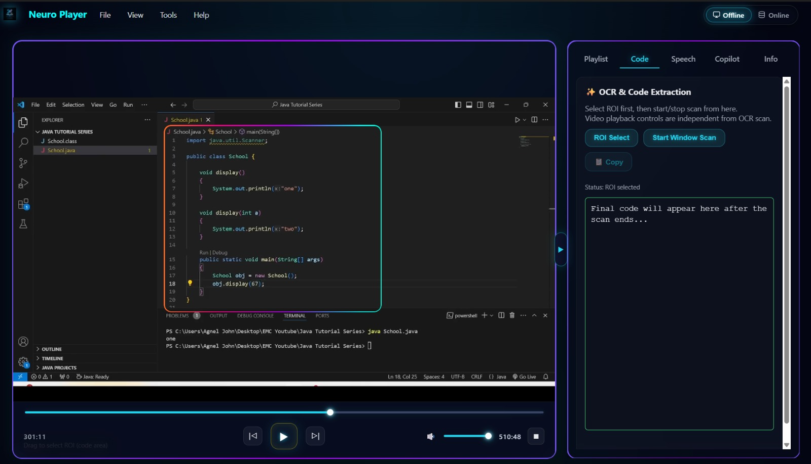
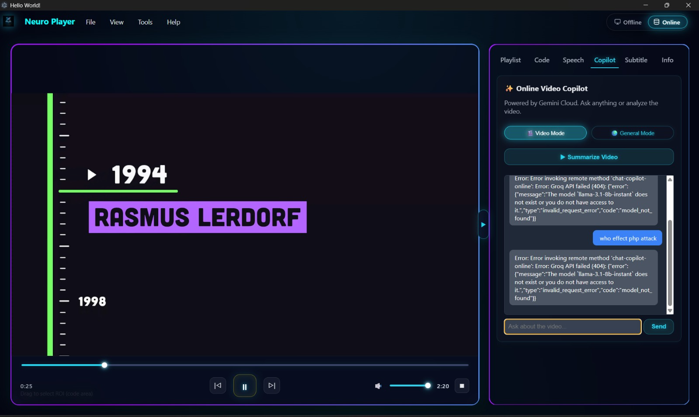
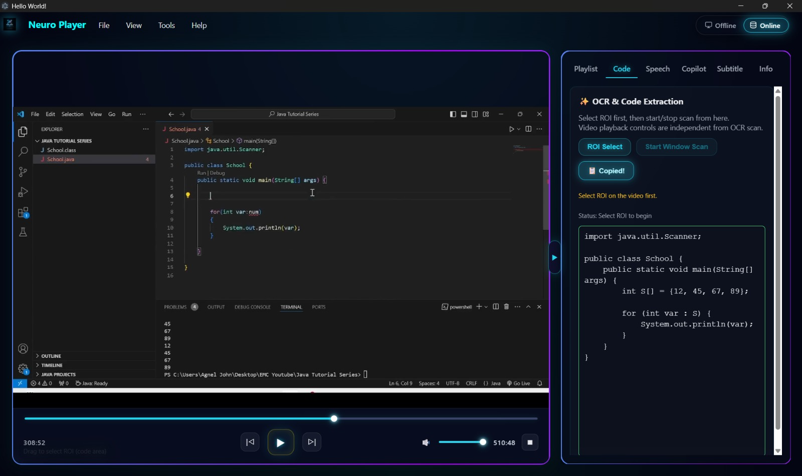

# NeuroMedia Player

An advanced desktop media player built with **React, Vite, and Electron**, featuring offline AI capabilities for video playback, code extraction, audio transcription, and AI-powered assistance.

## Features

- **Video Playback:** Play local video files with standard media controls.
- **ROI Code Extraction:** Select a region of a video and extract programming code using Tesseract.js OCR.
- **Offline Audio Transcription:** Convert video audio into text using Whisper AI.
- **Long Audio Processing:** Use Faster-Whisper with chunking and resume support for longer videos.
- **Local AI Copilot:** Ask questions and generate responses using the Qwen1.5-0.5B-Chat model.
- **Privacy-Focused:** Run AI features locally without requiring an internet connection after setup.

## Technologies Used

- **Frontend:** React, Vite
- **Desktop Framework:** Electron
- **OCR:** Tesseract.js
- **AI Models:** Transformers.js, Whisper, Qwen
- **Audio Processing:** Faster-Whisper, PyTorch
- **Online AI:** Google Gemini API

## Prerequisites

- Node.js (v18 or higher)
- Python (v3.8 – v3.11 recommended)
- Git (optional)

## Installation

1. Clone the repository and open the project folder.
2. Install Node.js dependencies:
   npm install
3. Install Python dependencies:
   pip install faster-whisper torch
4. Download the local AI models:
   node download-models.mjs
5. Create a `.env` file in the root directory and add your Gemini API key:
   GEMINI_API_KEY=your_actual_api_key

## Run the Application

Start the application in development mode:

npm start

## Build Application

Generate a standalone desktop application or installer:

npm run make

The generated files will be available in the `out/` directory.

## Offline Support

Most AI features run locally using downloaded models. Internet access is required for initial model downloads and Gemini-powered online code extraction.

## Author

P.Dishanthan
Computer Engineering Undergraduate

